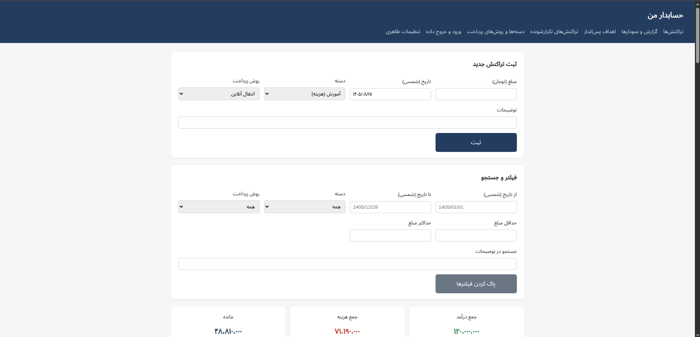
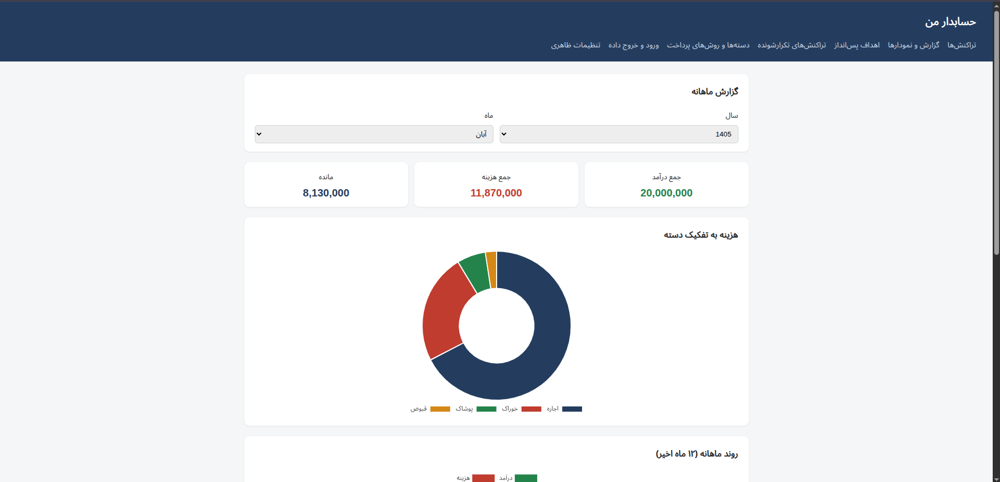
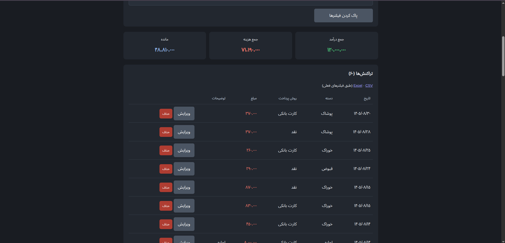
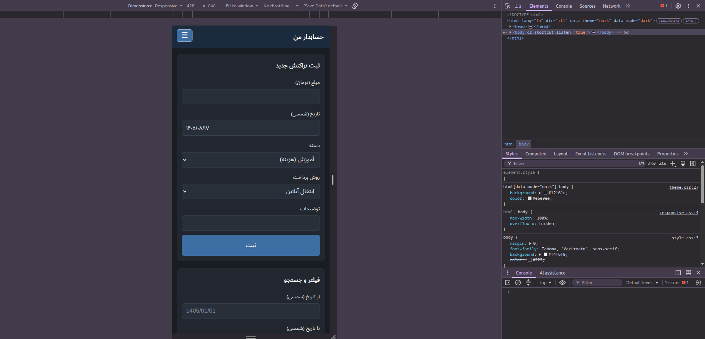

# حسابدار من (Hesabdar-e Man)

A Persian (RTL) personal finance web app built with FastAPI, SQLAlchemy and HTMX.
It uses the Jalali calendar and Persian digits throughout, works on phones and can be installed as a PWA.



## Features

- Income and expense transactions with categories and payment methods
- Edit, delete, filter and search (date, category, payment method, amount, text)
- Monthly report with pie, line and bar charts (Jalali months)
- Savings goals with progress bars
- Recurring transactions (weekly, monthly, yearly) created automatically
- CSV import and CSV/Excel export
- Jalali dates, Persian digits and live thousands separators
- Light, dark and system themes; Toman or Rial display
- Multi-user accounts with registration, login and per-user data isolation
- Scrypt-hashed passwords, signed session cookies and login throttling
- First-run welcome profile; one-time migration from the old single-user database

## Screenshots

| Report                     | Dark theme             | Mobile                     |
| -------------------------- | ---------------------- | -------------------------- |
|  |  |  |

## Tech stack

FastAPI · SQLAlchemy · SQLite · Jinja2 · HTMX · Chart.js · pytest · Docker

## Run with Docker

```bash
docker compose up --build
```

Open http://127.0.0.1:8000. Data is stored in `./data`.

## Run locally

```bash
python3 -m venv .venv
source .venv/bin/activate
pip install -r requirements-dev.txt
uvicorn app.main:app --reload
```

## Tests

```bash
pytest
```

## Project structure

app/
├── routers/ HTTP routes
├── services/ business logic (recurring, CSV, auth, migration)
├── templates/ Jinja2 templates
└── static/ CSS, JavaScript, icons, PWA files
tests/ pytest suite

## Design decisions

- Dates are stored as Gregorian and converted to Jalali only for display and input
- Amounts are integers in Toman; Rial is a display conversion
- The service worker caches only the offline page, never financial data

## Limitations

- Data is stored per user, but there is no email verification or password reset
- CSV import does not detect duplicates
- SQLite only; schema changes are applied with an add-only migration (no Alembic)

Designed by [Mohammad Safarzadeh](https://mksafarzadeh.ir)
